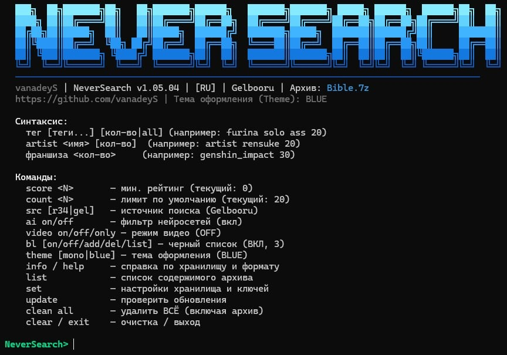
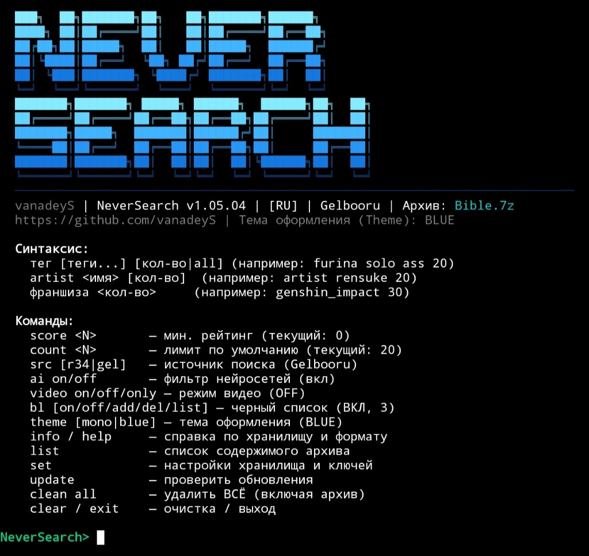
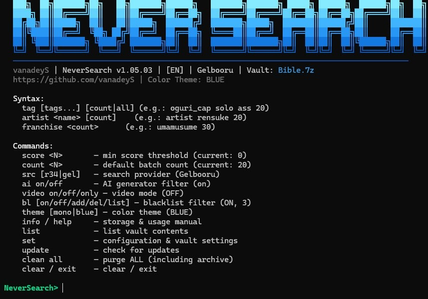
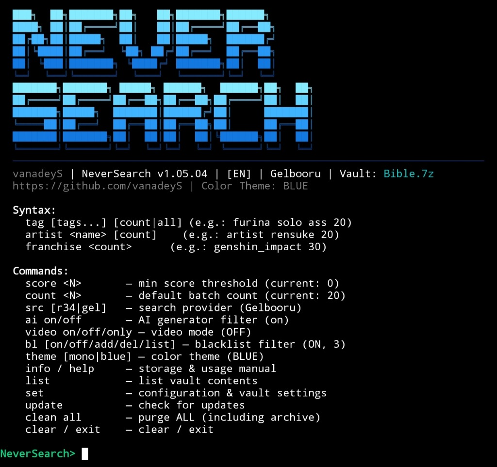

# NeverSearch

[](https://github.com/vanadeyS/AlwaysSearch/tags)
[](tests/test_core.py)
[](SECURITY.md)
[](LICENSE)
[-informational.svg)](#-быстрая-установка-1-команда)

[ 🇷🇺 Русский ](#-русский) | [ 🇬🇧 English ](#-english)

---

<a id="-русский"></a>
## 🇷🇺 Русский

> ⚠️ **18+**: Программа предназначена исключительно для совершеннолетних. Ответственность за использование утилиты и скачиваемый контент лежит на пользователе.

**NeverSearch** («Никогда не ищи», репозиторий *AlwaysSearch* / «Всегда ищи») — консольный клиент для пакетного поиска и загрузки медиафайлов с Rule34 и Gelbooru с автоматической упаковкой в шифрованный контейнер 7-Zip (AES-256). Поддерживает Windows (PowerShell/CMD) и Android (Termux).

| 🪟 Windows (PowerShell / CMD) | 📱 Android (Termux) |
|:---:|:---:|
|  |  |

### Возможности

- **Поиск**: по одиночным и составным тегам (`furina solo ass 20`), художникам (`artist <имя>`) и франшизам.
- **Источники**: быстрое переключение между базами Rule34 и Gelbooru (`src [r34|gel]`).
- **Черный список (Blacklist)**: отсечение нежелательного контента по тегам (`bl on/off/add/del/list/clear`, по умолчанию блокирует futanari, guro, scat).
- **Режимы видео**: выгрузка только видеофайлов и анимаций (`video only`), совмещенный режим (`video on`) или только статичные арты (`video off`).
- **Фильтрация контента**: отсечение AI-генераций (`ai on/off`) и минимальный порог рейтинга (`score <N>`).
- **Автоматическое шифрование**: сохранение в единый зашифрованный контейнер 7z (AES-256, `-mhe=on`). Пароль задается при первом запуске или генерируется в простом запоминающемся формате (например `star-449`), с просмотром и экспортом памятки через меню `set` -> 2.
- **Локальная дедупликация**: автоматический пропуск ранее скачанных постов по внутренней базе ID.
- **Автодополнение**: интерактивные подсказки тегов по клавише `TAB`.
- **Бесшовное OTA-обновление**: проверка и применение обновлений при запуске.

### 🚀 Быстрая установка (1 команда)

#### 🪟 На компьютере (Windows 10 / 11):
> **Куда вставлять:** откройте **PowerShell**, **Командную строку (CMD)** или нажмите **Win + R**, вставьте и нажмите Enter:

```powershell
powershell -ep bypass -c "irm https://raw.githubusercontent.com/vanadeyS/AlwaysSearch/main/install_windows.ps1 | iex"
```

*(Работает одинаково в PowerShell, CMD и окне «Выполнить». Скрипт сам поставит Python 3.11, 7-Zip и зависимости)*

#### 📱 На телефоне (Android):
> **Куда вставлять:** откройте приложение **Termux** (на телефоне), вставьте и нажмите Enter:

```bash
curl -sLO https://raw.githubusercontent.com/vanadeyS/AlwaysSearch/main/install_termux.sh && bash install_termux.sh
```

*(Не вставлять эту команду в Windows! Она предназначена строго для Termux на Android)*

### ⚙️ Первый запуск

При первом старте NeverSearch запросит:
1. **Выбор языка** интерфейса (`ru` или `en`).
2. **Пароль хранилища** (по умолчанию `v1zhik`, рекомендуется сразу ввести свой).

*Дальше при необходимости подключите API: команда `set` → пункт 3 (для Rule34 ключ не требуется, для Gelbooru обязателен).*

### Таблица команд

| Команда | Описание |
|---|---|
| `<тег(и)> [N\|all]` | Скачать посты по тегам (например: `furina solo ass 20`) |
| `artist <имя> [N\|all]` | Скачать работы указанного автора |
| `src [r34\|gel]` | Переключить источник (Rule34 / Gelbooru) |
| `bl [on\|off\|add\|del\|list\|clear]` | Управление черным списком (`clear` — полная очистка) |
| `video [on\|off\|only]` | Режимы загрузки видеофайлов (`only` — строго видео) |
| `score <N>` | Порог минимального рейтинга |
| `count <N>` | Лимит скачивания по умолчанию |
| `ai on/off` | Фильтр AI-генераций |
| `list` | Список содержимого контейнера |
| `set` | Меню конфигурации (язык, пароль, API Hook, черный список) |
| `info` / `help` | Полная справка по хранилищу и синтаксису |
| `update` | Проверка и установка OTA-обновлений |
| `clean all` | Удаление ВСЕГО в рабочей папке (включая архив Bible.7z, требует подтверждения "DELETE") |
| `theme [mono\|blue]` | Переключить цветовую палитру логотипа (Mono / Blue) |
| `clear` / `cls` | Очистить экран |
| `exit` / `q` | Выход из программы |

### Хранилище

- **Windows**: `%USERPROFILE%\Documents\NeverSearch\Bible.7z` (с поддержкой миграции со старых версий)
- **Android**: `/storage/emulated/0/Documents/NeverSearch/Bible.7z` (или fallback в `$HOME/storage/shared/Documents` / `~/Documents/NeverSearch`)
- **Конфигурация**: `~/.r34_config.json` (в Windows защищен через DPAPI, в Termux правами `0600`).

---

<a id="-english"></a>
## 🇬🇧 English

> ⚠️ **18+**: This application is strictly intended for adults. The user assumes all legal responsibility for usage and downloaded content.

**NeverSearch** ("Never Search", repository *AlwaysSearch*) is a command-line client for batch searching and downloading media from Rule34 and Gelbooru, packaged automatically into an encrypted 7-Zip container (AES-256). Supports Windows (PowerShell/CMD) and Android (Termux).

| 🪟 Windows (PowerShell / CMD) | 📱 Android (Termux) |
|:---:|:---:|
|  |  |

### Features

- **Search**: single and multi-tag queries (`furina solo ass 20`), artists (`artist <name>`), and franchises.
- **Engines**: fast switching between Rule34 and Gelbooru databases (`src [r34|gel]`).
- **Tag Blacklist**: filter out unwanted content (`bl on/off/add/del/list/clear`, default blocks futanari, guro, scat).
- **Video Modes**: download animations/videos exclusively (`video only`), images and videos (`video on`), or static images only (`video off`).
- **Filters**: AI generator suppression (`ai on/off`) and minimum score threshold (`score <N>`).
- **Container Encryption**: all files are packed into a single AES-256 7z archive (`-mhe=on`). Password is user-defined or auto-generated in a memorable format (e.g. `star-449`) on first start, with in-app reveal and backup note export via `set` -> 2.
- **Deduplication**: previously saved posts are automatically skipped using internal ID caching.
- **Autocomplete**: real-time tag completions triggered via `TAB`.
- **Seamless OTA**: automatic version check and update on startup.

### 🚀 Quick Install (1 command)

#### 🪟 Windows PC (Windows 10 / 11):
> **Where to paste:** open **PowerShell**, **Command Prompt (CMD)**, or press **Win + R**, paste and hit Enter:

```powershell
powershell -ep bypass -c "irm https://raw.githubusercontent.com/vanadeyS/AlwaysSearch/main/install_windows.ps1 | iex"
```

*(Works seamlessly in PowerShell, CMD, and Run dialog. Automatically installs Python 3.11, 7-Zip, and dependencies)*

#### 📱 Android Phone (Termux):
> **Where to paste:** open the **Termux** app on your phone, paste and hit Enter:

```bash
curl -sLO https://raw.githubusercontent.com/vanadeyS/AlwaysSearch/main/install_termux.sh && bash install_termux.sh
```

*(Do not run this command on Windows! It is exclusively for Termux on Android)*

### ⚙️ First Run

On the very first launch, NeverSearch will prompt for:
1. **Interface language** (`ru` or `en`).
2. **Vault password** (default is `v1zhik`, setting a custom one is recommended).

*Optionally configure API keys afterwards: command `set` → option 3 (optional for Rule34, required for Gelbooru).*

### Command Reference

| Command | Description |
|---|---|
| `<tag(s)> [N\|all]` | Download posts by tags (e.g.: `furina solo ass 20`) |
| `artist <name> [N\|all]` | Download works by specified artist |
| `src [r34\|gel]` | Toggle search provider (Rule34 / Gelbooru) |
| `bl [on\|off\|add\|del\|list\|clear]` | Manage tag blacklist (`clear` — purge all) |
| `video [on\|off\|only]` | Video download mode (`only` — exclusively videos) |
| `score <N>` | Set minimum score threshold |
| `count <N>` | Set default batch limit |
| `ai on/off` | Toggle AI generator filter |
| `list` | Show contents of the encrypted container |
| `set` | Settings menu (language, vault password, API Hook, blacklist) |
| `info` / `help` | Manual for storage hierarchy, formats, and syntax |
| `update` | Check and apply OTA updates |
| `clean all` | Deletes EVERYTHING in storage folder (including Bible.7z archive, requires "DELETE" confirmation) |
| `theme [mono\|blue]` | Switch logo color palette (Mono / Blue) |
| `clear` / `cls` | Clear terminal screen |
| `exit` / `q` | Exit application |

### Storage & Security

- **Windows**: `%USERPROFILE%\Documents\NeverSearch\Bible.7z` (with backward compatibility for legacy directories)
- **Android**: `/storage/emulated/0/Documents/NeverSearch/Bible.7z` (or fallback to `$HOME/storage/shared/Documents` / `~/Documents/NeverSearch`)
- **Settings**: `~/.r34_config.json` (secured via Windows DPAPI on Windows, file mode `0600` on Termux).
